# Between Takes Frame.io Process

## Metadata routes assets into existing collections

<!-- Notion synced block (source: Between Takes Frame.io Process, https://app.notion.com/p/4166d55232fa8002849eda831dcd92be#9698749c8520441e89002228d62a1f4e) -->

**Collection routing — owner correction, 2026-11-12.** Delivery uses metadata to funnel assets into the existing collections. This rule applies to every episode, revision and handoff and supersedes any instruction to create a share or manually add an asset to a share.

1. After actual-export QC and authorization, wait for the Terminal 1 cloud asset to show its thumbnail, runtime and upload timestamp. Set and verify Asset Type, **Brand / Company Name** (single-line text), Status and the current task's Release Date; observe documented episode-specific exceptions. Enter the approved company spelling exactly (for this episode, `HP`), trim extra spaces and use the same spelling in Notion and folder references. Brand identity is free text; workflow Status remains the existing controlled field.
2. Move that same asset into the established episode destination and preserve the correct version history/comments. Recheck metadata after the move or stack.
3. Allow the existing metadata-driven collections to route the asset. Inspect the appropriate existing collection to verify the exact asset/version appears. Review delivery uses In Review; Final Episodes requires explicit human final approval and matching metadata. Do not equate moving folders with verified collection routing.
4. **Do not click Share, Create Share Link or Add to Share Links as a delivery shortcut. Do not create episode/revision links, duplicate collections, manually curate share membership or change collection filters/access to force an appearance.** A new share requires Jackson's explicit request for that specific exception.
5. If routing fails, inspect saved metadata and existing collection criteria without changing them. **Brand / Company Name** is the current typed brand identity; preserve the original **Brand / Company** dropdown and its historical values. Adding a text field does not migrate dropdown data or retarget existing filters. If an existing rule depends on the old dropdown, document the exact dependency and obtain authorization for a separate verified migration; never change filters/access or manually add share membership to force routing. Conflicting dates, unavailable fields and inaccessible rules remain open checks. Notes is context, not a substitute for a required routing-field value.
6. Record the direct existing asset/stack address, exact version, saved metadata and collection verification in the existing Notion episode task; retain the review stage. A direct asset address is a reference to the asset, not a newly created share. Report pending checks honestly and keep Needs Agent Pass on while corrective work remains.

If a share is created accidentally, stop the share workflow, disclose it, disable its access promptly and verify the disabled state. Preserve the episode asset, comments and existing collections; record the correction. Do not claim a disabled share record was deleted.

<!-- end synced block -->

## Between Takes assembly line

### Agentic loop — filming to distribution

```mermaid
flowchart TD
    Film["1. Film episode"] --> Upload["2. Upload and verify originals in Frame.io"]
    Upload --> DIT["3. DIT: confirm episode number, four folders and inventory"]
    DIT --> Task["4. Update existing Notion episode page"]
    Task --> Media{"Required media available?"}
    Media -->|No| Blocked["Blocked: record missing items; keep Needs Agent Pass checked"]
    Blocked -->|Media recovered and verified| DIT
    Media -->|Yes| Edit["5. Editing agent: save separate revision in standard Premiere Pro"]
    Edit --> Style["Apply host close-up to wide intro, titles, camera cuts and sound rules"]
    Style --> Export["6. Export MP4 to Terminal 1 Frame.io mounted drive"]
    Export --> QC{"Final MP4 passes required audio sign-off and file QC?"}
    QC -->|No| Fix["Preserve failed file and log; fix in a new revision"]
    Fix --> Edit
    QC -->|Yes; disclose any deferrals| Ready["Ready for delivery: exact version, QC record and checksum"]
    Ready --> Label["7a. In Terminal 1: label processed asset and verify metadata"]
    Label --> Delivery["7b. Move same asset to correct Between Takes episode folder and stack"]
    Delivery --> Route["Existing collections route by metadata; no Share controls"]
    Route --> Verify{"Top version, metadata, automatic collection membership and history verified?"}
    Verify -->|No| Delivery
    Verify -->|Yes| Return["8. Update Notion: current Link, return record and verified resolutions"]
    Return --> Signal["Clear Needs Agent Pass only if no agent work remains"]
    Signal --> Round{"Current review round?"}
    Round -->|Internal| Internal["9. Human internal review: watch, listen and check content"]
    Round -->|Client| Client["11. Client review of exact delivered version"]
    Internal --> IDecision{"Internal review decision"}
    IDecision -->|Changes requested| Comments["Frame.io timestamped comments on reviewed version"]
    IDecision -->|Explicit approval| ClientStage["Human advances task to Client Review"]
    IDecision -->|No decision| Internal
    ClientStage --> Client
    Client --> CDecision{"Client decision"}
    CDecision -->|Changes requested| Comments
    CDecision -->|No decision| Client
    CDecision -->|Explicit approval| Approved["12. Human records approval and approved version; sets Complete"]
    Comments --> Capture["10. Tracking agent: copy each comment into episode-page checkbox"]
    Capture --> Source["Preserve author, timecode, text and source-version link"]
    Source --> Queue["Human checks Needs Agent Pass; retain current review stage"]
    Queue --> Edit
    Approved --> Final["DIT: approved final placement and Final Episodes collection"]
    Final --> Recovery["Verify native project and source/support recovery records"]
    Recovery --> Marketing["Marketing: clips, trailers, captions and thumbnails in 04_Social"]
    Marketing --> Release{"Approved assets and distribution authorized?"}
    Release -->|Needs changes| Marketing
    Release -->|Yes| Publish["Schedule and distribute full episode and promotional assets"]
    Publish --> Record["Record published links and handoff in the episode page"]

    classDef agent fill:#e8f0fe,stroke:#4267b2,color:#172b4d
    classDef human fill:#fff1d6,stroke:#b7791f,color:#5f370e
    classDef gate fill:#f3e8ff,stroke:#805ad5,color:#44337a
    classDef storage fill:#e6f4ea,stroke:#2f855a,color:#22543d
    class Edit,Style,Export,Fix,Ready,Label,Delivery,Return,Signal,Capture,Source agent
    class Internal,Client,ClientStage,Queue,Approved,Marketing,Publish human
    class Media,QC,Verify,Round,IDecision,CDecision,Release gate
    class Upload,DIT,Final,Recovery,Record storage
```



**Blue:** agent work. **Gold:** human review, decisions and downstream work. **Purple:** checks and decisions. **Green:** organization and records.

**Read the loop:** [Frame.io](http://Frame.io) feedback → individual source-linked Notion checkboxes → Needs Agent Pass → separate edit revision → actual-export QC → verified delivery → resolution record → the same review stage. Internal and client feedback use the same revision loop; only a human advances approval. No response is not approval.

Keep the current review stage when returning a revision; do not automatically downgrade Client Review. Check actionable items only after the actual revised export and delivery are verified. A new top version never replaces the earlier source-version links or comments.

This flow documents the operating process. It does not establish that automatic comment syncing, reminders, marketing production or distribution are configured. Marketing and publication proceed only under the relevant authorization. Detailed numbered steps and the DIT folder requirements follow below.

**Film → upload originals → organize episode → edit → check export → deliver → internal review → capture comments in Notion → revise → verify and return → client review → human approval and marketing.**

This is the operating workflow for [BrandStar Tasks](https://app.notion.com/p/c72ead98bcd44c8c8d22dc758c638d0b). Each episode keeps its existing Notion task page and [Frame.io](http://Frame.io) version history. The sequence follows Jackson’s supplied process sketch and expands the review/return loop. Review-page layouts and handoff checks below describe how each pass should be run; they do not establish that a live comment-sync or notification automation is installed.

### Who owns each handoff

| Owner | Responsibility | Passes forward when |
| --- | --- | --- |
| Recording / media intake | Recorded footage/audio and source organization | Originals are identified and completeness is checked |
| Editing agent / editor | Premiere revision, edit changes and actual-export QC | Exact finalized MP4 is Ready for delivery |
| Delivery / tracking agent | [Frame.io](http://Frame.io) metadata, filing, stack verification and episode-page records | Delivered version and review link are verified |
| Internal reviewer / Jax | Watch/listen, leave timestamped feedback and decide internal approval | Requests are explicit or internal approval is recorded |
| Client reviewer | Review the approved client-facing version and confirm requested changes | Explicit client approval is recorded |
| Human owner | Approval, Complete and authorized marketing/publication handoff | Required decisions and outstanding caveats are accounted for |

Only the editor controls Premiere. The delivery agent owns [Frame.io](http://Frame.io) delivery and episode tracker writes; the coordinator resolves conflicts. Preserve original media, earlier exports, versions, comments and production history.

## 1. Film and identify the recording

**Owner: recording / media intake.**

Record the episode and identify the company, recording/day, people and available camera/audio files. Keep separate episodes and recording days separate. Record unknown names or incomplete files as gaps rather than guessing.

**Exit check:** the recording can be identified and its available source files are listed.

## 2. Upload and check the originals

**DIT checkpoint:** follow **DIT organization checks — every episode and revision** below. Inventory originals before moves, preserve complete camera-card folders and sidecars, and verify the shared episode folder structure before handing media to the editor.

**Owner: media intake / delivery agent.**

Locate the original camera footage and recording audio in [Frame.io](http://Frame.io); check existing locations before downloading or uploading another copy. Verify completeness rather than treating an empty folder, partial download or review MP4 as source backup. Record missing footage/audio in the episode page and flag the blocker.

Follow the protected source and project-folder rules in [Between Takes Editing Rules](https://app.notion.com/p/4166d55232fa808d8183f0507b4a6c88). Existing external originals on Brandstar04 and BS-93 stay in their confirmed locations.

**Exit check:** the editor has verified access to the required media, or the task is Blocked with the missing items recorded and Needs Agent Pass checked.

## 3. Organize the episode in Notion

**DIT checkpoint:** confirm the approved episode number/brand and the four exact shared-library folders. Record the folder link, dated move manifest, inventory checks and unresolved items in this episode page’s DIT organization section.

**Owner: delivery / tracking agent.**

Open the existing episode row in the Podcast view, then open the page itself. Match the company, episode number and recording/day before changing anything. Preserve separate multipart or repeat assignments.

### Notes — one sentence, always current

Use exactly **one short sentence** in the Notes property. Update it when the project’s stage or blocker changes; replace the old status rather than appending to it.

Examples:

- “v03 is in internal review, awaiting Jackson’s feedback.”
- “Blocked until the missing camera B footage finishes downloading.”
- “v04 passed QC and is awaiting labeling and stacking in Between Takes.”
- “Client changes are being applied in v05.”
- “Awaiting human sound and lip-sync review before delivery.”

Keep full review comments, checklists, QC evidence, delivery records, paths and production history in the **episode page body**. Before shortening an existing long Notes field, preserve any unique substantive information there. The Notes field is the current status, not a history log.

### Use the existing fields correctly

| Field | What belongs here |
| --- | --- |
| Name | Existing company / episode identity |
| Due Date | Scheduled task date; verify the episode’s actual air date before using it for [Frame.io](http://Frame.io) Release Date |
| Status | Current human-approved workflow stage |
| Needs Agent Pass | Checked when agent work is pending; cleared after verified delivery when no agent work remains |
| Link | Current verified [Frame.io](http://Frame.io) episode/stack link after delivery |
| Notes | Exactly one short sentence stating the episode’s current stage/next action or the specific blocker |
| Source | Original task page in the main Notion workspace, if known; preserve it as a Notion provenance link |

Some current Link values point to source folders while delivery is pending. Label that clearly in Notes and the page body. After review delivery, verify and replace Link with the current review asset/stack URL; preserve the original media location separately in the page body. Never put the [Frame.io](http://Frame.io) review URL into Source.

**Exit check:** one existing episode page holds its identity, references, current work signal and next action.

## 4. Edit a separate revision

**Required app:** use the standard release of Adobe Premiere Pro for all editing, revisions, native checks and exports. Never use Premiere Pro Beta. Confirm the app before opening/saving; preserve and report an incompatible project instead of switching to Beta. This applies to every initial edit and revision return.

**Owner: editing agent / editor.**

Refresh the task and comments, preserve newer user edits, and Save As a separate native project. Apply [Between Takes Editing Rules](https://app.notion.com/p/4166d55232fa808d8183f0507b4a6c88), [Between Takes Multi Cut Style](https://app.notion.com/p/4166d55232fa804296fbc7c476c8ecf7), [Between Takes Animation Style](https://app.notion.com/p/4166d55232fa808189c5dfdb82f9381f), [Between Takes Sound Engineering Rules](https://app.notion.com/p/4166d55232fa806dade1fb1ce41db0f1) and [Between Takes Intro and Outro](https://app.notion.com/p/4166d55232fa80bba951d41ad90d0566).

For an initial edit, coordinate In progress. During internal revision passes, retain In Review and use Needs Agent Pass to signal pending work. Do not overwrite a human Client Review or Complete status merely to run a pass; record the current substage and have the human owner decide any stage change.

**Exit check:** a separate saved revision implements the authorized work and identifies unresolved items.

## 5. Check the content and finalized export

**Required on every export:** complete the full [Between Takes Sound Engineering Rules](https://app.notion.com/p/4166d55232fa806dade1fb1ce41db0f1) and per-export audio sign-off. Audio verification includes full listening with picture, mic timing/sync, natural dialogue, routing, music/transitions and actual stereo-file measurements. Failed checks require correction; pending mandatory checks hold Ready for delivery unless an explicit owner-authorized review-draft exception is documented. Preserve existing export holds.

**Owner: editing agent / editor.**

1. Open the actual native revision and check the rendered picture.
2. Verify guest identities/roles and seating, title placement/timing, gradient and camera cuts.
3. Check the full opening and closing: approved Version 04 picture and sound, a clear first word, complete final thought and full outro.
4. Check conversation changes in context, natural joins, pacing, removal of production chatter and any unresolved clearance concerns.
5. Confirm picture/dialogue sync, every intended music/dialogue feed, 1920 × 1080 framing, episode frame rate, runtime and full-file integrity.
6. Measure the actual stereo export’s true peak and integrated loudness; listen to the actual MP4 for sound problems.
7. Finish encoding and verify stable file bytes before recording the checksum and releasing the export.
8. Record a result for each applicable check: passed, failed or explicitly deferred. Deferred human listening/lip-sync review is never passed.

Use the complete checklist in Editing Rules. Failures return to step 4; preserve the failed file/log. A file cannot move forward merely because it exists in Terminal 1.

**Exit check:** the exact finalized MP4 has a QC result, checksum, version and disclosed caveats.

## 6. Deliver the checked version to [Frame.io](http://Frame.io)

**DIT checkpoint:** recheck the episode location and current project/support folders on every delivery. Preserve review stack history and comments; reserve the episode’s outer-level MP4 for the human-approved final. Apply the DIT instructions below without relocating the separate local working media.

**Owner: editor → delivery agent.**

The editor exports directly from standard Premiere Pro into the **Terminal 1** [**Frame.io**](http://Frame.io) **mounted drive**, `/Volumes/Terminal-1/`. Complete the audio sign-off and finalized-file QC before releasing that exact version as **Ready for delivery**.

The delivery agent then follows this order:

1. Keep the asset in Terminal 1 until processing shows its thumbnail, runtime and upload timestamp.
2. **Label it in Terminal 1:** apply and verify Podcast, the approved company name typed into **Brand / Company Name**, Internal Review and the refreshed Notion release date. Preserve the approved blank-date exception for celebrity replays and historical dropdown values.
3. **Then move that same asset** into the correct existing company/episode folder within **Between Takes Podcast**, following the DIT structure and confirmed episode identity.
4. Apply the required ongoing episode version history to every delivery, including new episodes. Use the matching stack or establish it from genuine matching versions when absent; retain the first genuine delivery as the base when no earlier version exists. Add later revisions to that same stack, verify the latest actual edit is on top, and preserve all previous versions/comments. Follow Episode naming and required version history below.
5. Recheck metadata after the move/stack, confirm existing In Review membership, and update the episode’s current Notion Link and delivery record.

Do not export directly into Between Takes or create a second upload to bypass Terminal 1. If Terminal 1 is unavailable, hold delivery and report it.

Use the detailed handoff, metadata and stacking checks later in this document. Keep the latest actual edit on top and preserve previous versions/comments. Verify membership in the existing In Review collection; do not create a new share.

Update the episode’s Link, current version and delivery evidence. An upload is review delivery, not approval.

**Exit check:** the exact verified version is accessible through the correct current review link and its metadata/history are intact.

## 7. Review the content internally

**Owner: internal reviewer / Jax.**

1. Open the episode’s Notion page, follow Link to [Frame.io](http://Frame.io), and confirm the filename/version before reviewing.
2. Watch and listen to the episode, including the opening, titles, camera changes, conversation edits and full ending. Check names/roles, picture, sound and lip sync; pay particular attention to disclosed gaps or deferred checks.
3. Leave each edit request on the relevant [Frame.io](http://Frame.io) version at its timestamp. State the requested change and enough context to identify the intended cut or correction.
4. Keep approval separate from edit requests. Record any decision to defer a check and the exact scope of that deferral.
5. Use the established 5-day notes window plus 2-day closeout. The existing reminder pattern is day 5, final day 6, then one digest per asset at day 7. This document does not create or verify those automations; do not email reviewers.
6. No response at the end of the window is not approval. Outstanding requests continue into the revision loop; a human records the decision to advance.

**Exit check:** timestamped comments or an explicit internal approval decision exist for the reviewed version.

## 8. Show the [Frame.io](http://Frame.io) comments inside the episode’s Notion page

**Owner: delivery / tracking agent.**

[Frame.io](http://Frame.io) remains the source of review comments. Notion holds a visible, actionable copy in the **body of that episode’s page**, using the established Everstory-style headings and native checkboxes. Do not bury the detailed review in the short Notes field or only in Notion’s discussion sidebar.

1. Open the exact reviewed [Frame.io](http://Frame.io) version and read its comments and relevant replies. Check older versions for carried-forward unresolved requests.
2. Create a review-round heading identifying the source edit version, filename, capture date and version-specific [Frame.io](http://Frame.io) source link. Keep the current delivered stack link separate.
3. Copy each original comment into its own native checkbox. Preserve author, timestamp/timecode, original wording and source version/link. If no timecode exists, label it General rather than inventing one.
4. Group requests under headings such as Lower thirds, Edit changes, Sound, and Content / clearance. Preserve original wording and put the editor’s interpretation in a separate action note.
5. Keep related cut/start comments as separate items, cross-reference them, and explain the combined action. Do not collapse multiple original comments into an untraceable summary.
6. Keep pending requests unchecked. Mark ambiguous requests Needs clarification; retain Needs Agent Pass while work remains.
7. Reconcile the copied items against the source comments. Record how many were captured and when. Reuse an existing comment ID/direct link to prevent duplicates when available; otherwise match version, author, timecode and text.
8. On refresh, add new comments and replies without duplicating existing items, removing earlier rounds or resetting verified resolutions.
9. After requests are captured, a human checks Needs Agent Pass to queue the pass. If it is already checked, retain it. Notes identifies the round/version and next action.

### Episode-page layout to use

The following is a reusable layout with placeholders, not a live review record. Replace placeholders only with verified episode information.

**Current review**

- Latest delivered version: \[edit version and filename\].
- Watch current episode: \[verified current [Frame.io](http://Frame.io) stack/asset URL\].
- Stage / next owner: \[internal review, agent revision, client review or other supported stage\].
- Outstanding caveats: \[unconfirmed labels, deferred sound/lip-sync, content concerns or None verified\].

[**Frame.io**](http://Frame.io) **Review Notes — Round \[number\] / source edit \[version\]**

Source: \[exact reviewed filename/version\]. [Frame.io](http://Frame.io) source: \[version-specific asset URL\]. Comments captured: \[date/time and count\]. Keep this source fixed even when a later edit becomes the top version.

**Lower thirds**

- [ ] \[source timecode\] — \[original author\]: “\[original comment text\]”. Source: \[direct comment link if available; otherwise exact version link\]. Action: \[specific requested change\]. Resolution: Pending.

**Edit changes**

- [ ] \[source timecode\] — \[original author\]: “\[original comment text\]”. Source: \[comment/version link\]. Action: \[specific requested change\]. Resolution: Pending.

**Sound / content / clearance**

- [ ] \[source timecode or General\] — \[original author\]: “\[original comment text\]”. Source: \[comment/version link\]. Action or clarification needed: \[details\]. Resolution: Pending.

**Revision return — edit \[new version\]**

- Delivered review: \[verified current link\].
- Changes verified: \[request numbers / concise result\].
- Still open or deferred: \[items and reason\].
- QC / delivery evidence: \[report, version, runtime and metadata/stack check\].
- Next action: \[reviewer decision needed\].

**History and recovery**\
Retain earlier review rounds, delivery records, original-source locations, native-project links and separate recovery-backup checkboxes.

### What a checked item means

An actionable checkbox stays unchecked until the revised actual export is checked and that version is delivered. Then retain the original comment and append the delivered edit version, resolution and new output timecode when cuts changed timing. It means the request was verified in delivery; it is not client approval and does not resolve the [Frame.io](http://Frame.io) comment.

A context-only comment may be checked as **Reviewed — no edit required**, with a reason. A rejected, unclear or deferred request remains explicit and must not be silently described as implemented.

See [Best Buy Health](https://app.notion.com/p/40f6d55232fa8120beaad8c8d478be5b) for an existing example of individual original comments, version-specific source links and delivered-version resolutions. [Everstory Partners / StoneMor](https://app.notion.com/p/40f6d55232fa818e868ac8b807243fa4) shows the grouped review-note layout. These are format references; do not infer checkbox completion from a task status alone.

**Exit check:** each review item is traceable to a source version and appears as a native checklist item in the existing episode page.

## 9. Send the work back through the editor

**Owner: reviewer / tracking agent → editing agent.**

1. The editor picks up the existing episode task with Needs Agent Pass checked, reads the full source-version checklist and opens the linked [Frame.io](http://Frame.io) context.
2. Resolve ambiguous identities, cut boundaries or conflicting comments before applying the dependent change. Preserve each unresolved item and its explanation.
3. Save a new native revision, implement the authorized actions and record how source timecodes map to the new timeline.
4. Keep checklist items pending through editing and export. Timeline changes alone do not establish a delivered fix.
5. Repeat steps 5–6 for the revised actual MP4. The editor hands off that exact Ready for delivery version; delivery verifies the returned stack.

If media or access blocks the pass, use Blocked, retain Needs Agent Pass and record the missing item/next action. Continue available work on other episodes.

**Exit check:** the revised version has passed applicable QC and verified delivery, with each request ready for resolution review.

## 10. Verify the fixes and return the episode for another review

**Owner: delivery / tracking agent → reviewer.**

1. Compare every requested action against the actual delivered revision at the relevant new output timecodes. Confirm all cut boundaries and resulting joins, not only the presence of a new file.
2. Verify current top version, metadata, preserved older versions/comments and existing In Review collection membership.
3. Check only the implemented and verified items; append a clear resolution and delivered version. Keep outstanding requests unchecked and label approved deferrals explicitly.
4. Add the detailed Revision return record in the episode page. Update Link to the current verified stack and replace Notes with exactly one short sentence giving the current stage/next action or blocker. Keep detailed changes, caveats and old source-version links inside the episode page.
5. For an internal review pass, retain In Review. Clear Needs Agent Pass only when the agent’s work is verified and no agent action remains; otherwise leave it checked. Preserve a human-set Client Review or Complete stage rather than downgrading it automatically.
6. “Sent back” means the same episode page and existing review collection now point to the verified revision with a clear return record. Any separate reviewer notification uses only the established authorized channel; do not create a new share or send an email as part of this documentation task.
7. The reviewer opens that returned version and checks the fixes in context. New or remaining requests return to steps 8–9. Explicit internal approval advances to step 11.

**Exit check:** the reviewer can identify what changed, which version contains it, what remains and where to review it.

## 11. Client review and confirmation

**Owner: human coordinator / client reviewer.**

After explicit internal approval, the human coordinator advances the existing task to Client Review and routes the verified approved-for-client version through the established authorized review channel. Record the exact version/link and internal approval evidence in the episode page.

Client comments follow the same traceable loop: comments on the correct [Frame.io](http://Frame.io) version → a separately labeled Client review round in the episode page → Needs Agent Pass → new edit → QC → verified delivery → client recheck. Preserve the Client Review stage unless a human changes it.

Record client confirmation explicitly with the version, decision, decision-maker and date. Silence, checked edit items and successful delivery do not establish client approval.

**Exit check:** the required client decision is recorded, or the task clearly shows the pending client requests/decision.

## 12. Human approval, final handoff and recovery

**DIT checkpoint:** verify the human-approved full-episode MP4 at the episode outer level, current native/support materials in 03\_Premier Edit, social materials in 04\_Social, and retained historical material in 01\_Archive. Preserve all files and resolve competing final candidates with the owner. Record organization and recovery as separate checks.

**Owner: human owner / delivery agent.**

Only a human sets Complete after the required approvals and outstanding caveats are accounted for. Only human-approved finished episodes go to Final Episodes. Record the approved version and handoff to marketing/clips/publication; those downstream actions require their own authorization.

Back up the latest verified delivered native project and linked recovery support using the checks below. Keep project upload separate from original/support recovery verification. Never infer permission to remove media from an approval or a project upload.

**Exit check:** final approval and version are recorded; downstream work and recovery verification have clear owners/status.

## Detailed delivery and backup reference

The existing handoff, metadata, stacking, closeout and recovery requirements follow below. Use them at the delivery stations above. The assembly line adds the review and return steps while preserving the earlier process.

Expanded on 2026-11-12 from Jackson’s process sketch, the Podcast task fields and existing episode-page examples. This documentation pass does not change live episode statuses, checkboxes, approvals or notification automations.

---

Take only verified exports through Terminal 1 into the existing review structure. The editing agent owns Premiere and export QC; the delivery agent owns [Frame.io](http://Frame.io) delivery and episode tracker writes. Coordinate ownership so agents do not overwrite each other or duplicate deliveries.

## 1. Accept the verified handoff

Use **Exporting / QC pending → Ready for delivery → Delivered**. A file appearing in Terminal 1 or an upload starting is not a verified handoff. Resolve incomplete handoffs or wrong-version details with the editing agent before filing.

Each Ready for delivery record must include:

- Episode and existing Notion task; refreshed air date.
- Protected native-project path, separate source-only download directory and any external original-source locations.
- Exact Terminal 1 export filename/path and edit version.
- Runtime, format, export QC report/result and checksum.
- Destination/company folder and known stack.
- Remaining label gaps and explicitly deferred checks.

Keep source locations separate from project/support homes. The editing agent owns the producer record; the delivery agent writes a separate delivery result. Shared records live in `00_Agent Resources/Delivery Handoffs`, with episode details in the company’s Notes folder.

Use [Between Takes Editing Rules](https://app.notion.com/p/4166d55232fa808d8183f0507b4a6c88) for finalized-byte stability and QC requirements. Failed or unfinished exports remain out of delivery.

## 2. Verify upload and metadata

1. Wait for the cloud asset’s thumbnail, duration and upload timestamp.
2. Refresh the Notion episode air date, then set and verify:
   - **Asset Type:** Podcast.
   - **Brand / Company Name:** single-line text with the approved covered company name; use consistent exact spelling, such as `HP`.
   - **Status:** Internal Review.
   - **Release Date:** refreshed Notion air date, never the filename/export date.
3. Leave Release Date blank for celebrity replays: Dr. Drew and Mario + Courtney Lopez.
4. Type company identity into **Brand / Company Name**; do not add brand dropdown options for new delivery. Preserve existing **Brand / Company** dropdown history and rules until any separately authorized migration is verified. Reuse existing controlled options for Status and Asset Type. Flag unavailable fields or missing/conflicting air dates instead of guessing.
5. Recheck after processing because early values can reset. Missing guest names use visible placeholders and `PLACEHOLDER GUEST` filenames; Best Buy Health, Apellis and Inspire placeholder drafts must not be presented as final.

## Episode naming and required version history

### Clean filenames

Use `Brand - Between Takes Podcast - v##.mp4` for new full-episode exports. Example: `HP - Between Takes Podcast - v02.mp4`, rather than “HP Jeanne review comments v02.”

- Use the approved brand name and a two-digit minimum version number. Keep the current edit’s established numbering; do not reset existing episodes.
- Keep reviewer names, feedback-round descriptions, “review comments” and export dates in the episode’s Notion review/delivery records, not in the standard filename. This supersedes the earlier date-in-export-filename rule.
- When the same brand has distinct episodes, recording days or parts, add only the verified identifier needed to distinguish them: `Brand - Between Takes Podcast - Episode 02 - v03.mp4`, `Brand - Between Takes Podcast - Day 01 - v02.mp4`, or `Brand - Between Takes Podcast - Part 01 - v02.mp4`. Use existing approved identifiers; never invent episode numbers.
- Keep the required `PLACEHOLDER GUEST` marker on review drafts with unconfirmed identities. Clean naming does not mean hiding a required caveat.
- Use the same clean base for new native revisions with `.prproj`; keep processing/reviewer details in Notes and manifests.
- Preserve existing historical filenames and source links. These are naming rules for new saves/exports, not a direction to rename existing media or archives.
- A simple stack display name is `Brand - Between Takes Podcast`, with the same necessary episode/day/part identifier. Keep each member’s actual edit version identifiable in its filename. The edit’s v02 and [Frame.io](http://Frame.io)’s stack position V2 are separate facts; record both accurately.

### Required for new and existing episodes

Every episode must have one ongoing video version history. This is required delivery work, not optional housekeeping.

1. For a new episode, record the first genuine delivered edit as the base version and retain its link in the existing Notion episode page.
2. If a matching episode stack exists, add the new delivery to it. If none exists, establish that episode’s stack from genuine matching delivered versions; add all subsequent revisions there. Never upload a duplicate or invent a version to force a stack badge.
3. Where only one genuine version exists, record it as the initial/base delivery; on the next delivery, stack it with the new actual revision. Do not claim a multi-version stack has been verified before it exists.
4. Reconcile same-episode standalone revisions into the stack while preserving each asset’s comments and version identity. Do not combine different episodes, recording days, parts or audio-only support.
5. Confirm the latest actual edit is on top using filename, runtime and Version History, not upload time or stack-position number alone.
6. Record the current stack URL, edit version, stack position and verification result in Notion. Preserve version-specific links attached to earlier review notes.
7. A failed stacking operation remains an open delivery issue: keep Needs Agent Pass checked, describe the blocker and do not call the pass fully delivered.

The delivery route remains **export to Terminal 1 mounted drive → audio/file QC → label and verify there → move the same asset to the correct Between Takes episode folder → stack and verify**. Never bypass Terminal 1.

## 3. Move, stack and verify

1. Before stacking, record existing versions and their comment counts.
2. Move the same verified asset from Terminal 1 into the correct company/episode location in **Between Takes Podcast**.
3. Add it to the matching existing video stack. Consolidate older standalone uploads of that same episode while preserving every version and comment.
4. Keep separate episodes, recording days and audio-only assets separate. Each Lopez recap day is its own episode/project.
5. Confirm the latest actual edit is the top/newest version using the fresh folder card’s filename/runtime and Version History. Open history from the version badge and reorder when needed.
6. Recheck Podcast, company, Internal Review and Release Date after moving/stacking.
7. Verify older comments remain on their original versions. A new top version may have zero comments; never resolve or delete older comments as part of filing.
8. Verify the exact asset/version appears automatically in the existing **In Review** collection through saved metadata. Do not use Share, Create Share Link or Add to Share Links; do not manually add membership or change collection rules. If absent, inspect metadata and existing criteria, record the gap and keep the delivery check pending.
9. Open the current folder/project stack card, copy its stable current URL, and verify it opens the latest actual edit. A newly created stack may have a different URL from the earlier individual asset.
10. Save a small bookmark to that same delivered asset/stack in the protected episode’s `Review Exports`. Preserve older references; do not duplicate large videos on the SSD or create another share to fill this folder.

## 4. Record feedback and close the pass in Notion

1. Update the existing task’s Link and replace Notes with exactly one short current-status sentence. State where the episode stands or what is holding it up; do not append paragraphs or a running history. Before replacing older substantive Notes, preserve any unique feedback, caveats, paths or history inside the episode page.
2. Keep detailed feedback inside the episode page in the Everstory format: source/version, relevant headings and timestamped native action checkboxes.
3. Give each reviewed comment or review item its own checkbox; retain original author, timestamp, text and source version/link. Pending edits stay unchecked.
4. Check an item only after verifying the actual revised export and delivery; note the delivered version and resolution. Context-only comments can be reviewed/no edit required with a brief explanation.
5. Preserve original comments, earlier checklists and production history. Checking a Notion item does not authorize resolving or deleting its [Frame.io](http://Frame.io) comment.
6. After verified review delivery, keep **In Review**, clear **Needs Agent Pass**, and add `Finished the edit based on revisions; awaiting review.` Record edit version, delivery location, top-stack version, metadata/date checks and stage, such as `Edit complete; awaiting internal review in Frame.io.`
7. If work remains, leave Needs Agent Pass checked. Missing local content is Blocked with a short explanation.
8. Only a human sets **Complete**. In Review episodes remain Active; task completion is neither client approval nor publication.
9. Report the delivered link, location, edit/top-stack version and metadata verification to the editing agent/coordinator. Do not operate Premiere or export a second copy.

### Work signal

Humans check Needs Agent Pass when new [Frame.io](http://Frame.io) comments arrive; the agent clears it after verified delivery. Review tasks remain In Review through revision passes. Unchecked means no agent work pending.

## 5. Run the review cycle

- [Frame.io](http://Frame.io) is the only comment source; reflect those comments in Notion.
- Internal review has a **5-day notes window**, then **2-day closeout**.
- Existing reminder process: day-5 nudge, final day-6 nudge, one digest per asset at day-7 closeout. This playbook does not create or verify those automations. Do not email reviewers.
- Further authorized feedback becomes a new revision through [Between Takes Editing Rules](https://app.notion.com/p/4166d55232fa808d8183f0507b4a6c88), then repeat delivery verification.
- After explicit approval: client review → client confirmation → marketing/clips → publication. No upload, stack or finished agent pass establishes approval.

## 6. Back up the verified native project and recovery assets

### Project backup and SSD recovery

For completed episodes and finished revision passes, save the latest verified native `.prproj` in the matching existing company/episode **03\_Premier Edit** folder in [Frame.io](http://Frame.io). Identify the latest version from delivery and revision evidence; migration timestamps and an old START HERE file are not sufficient. Preserve older project backups and keep native projects separate from review-video stacks.

A Premiere project does not contain its source footage or all linked support assets. When original footage already exists in [Frame.io](http://Frame.io), record and verify its exact original source location rather than uploading another copy. An empty expected folder or a rendered review MP4 does not establish that originals are backed up; search other recorded locations and flag any gap. Back up locally generated linked assets needed for recovery, including dialogue mixes, graphics and other supporting files, with an original-path/source-location manifest and local checksums. Preserve shared branding references and record required fonts or other external dependencies.

The delivery agent verifies each uploaded project's filename, size and cloud location, then adds a native Notion checkbox with the project version and backup link inside the episode page. Track **Project uploaded** separately from **Originals and supporting assets verified for recovery**. Do not change a human Complete status or the review-video link merely because a project backup was added. A draft or unverified media-relocation project must not replace the verified delivered project backup.

Only identify a concrete local-media cleanup list after original cloud sources and project/support recovery have been verified. Keep original files while any dependency or backup is uncertain. Preserve the existing no-deletion instruction; project upload alone does not authorize local source removal.

Track project upload and recovery verification as separate native episode-page checkboxes. Do not replace the verified delivered backup with a draft or unverified relocation project. External originals on Brandstar04 and BS-93 stay in their confirmed locations; do not move or duplicate them.

## Existing review collections

Exactly two team-facing collections are used:

- **In Review:** [Open review collection](https://f.io/2p6uValA). Includes review drafts and celebrity replays. This link is public: anyone with it can view, download and comment; Jackson approved celebrity replays here.
- **Final Episodes:** [Open approved episodes](https://next.frame.io/share/8bd701b8-4094-49fe-a840-fe89e39f72b2). Only human-approved finished episodes belong here.

Reuse these existing metadata-driven collections. Set and verify asset metadata, then inspect automatic collection routing. Never use Share, Create Share Link or Add to Share Links for routine delivery, create episode/revision shares, duplicate collections, or alter collection rules/access to force routing. A new share requires Jackson’s explicit request for that specific exception.

## Preserve review and support history

After the editing agent releases files from QC comparisons, preserve superseded QC-only exports and standalone audio support in the existing Terminal 1 / Archive, clearly labeled. Keep successful earlier review videos in episode version history with comments. Never stack audio-only support with video or delete anything.

## Source and authority

Organized from [Between Takes Podcast Editing](https://app.notion.com/p/40f6d55232fa81898aaae3a84d0888b8) on 2026-11-12. Follow the latest explicit episode instruction when it conflicts with a default. Preserve originals, revisions, comments and production history; never delete anything. This documentation does not authorize editing, exporting, publishing or scheduling by itself.

## DIT organization checks — every episode and revision

Apply the supplied DIT instructions below to the [**Frame.io**](http://Frame.io) **mounted library at `/Volumes/Between-Takes-Podcast/`**. They govern the shared episode library. The separate SSD editing workspace, Terminal 1 export route and confirmed external-source exceptions remain governed by Editing Rules; do not reorganize or relocate those drives under the DIT instructions.

The DIT role is the organization responsibility at intake and delivery. Coordinate it with the delivery agent so two people or agents do not move the same episode simultaneously.

### Required shared-library structure

```txt
/Volumes/Between-Takes-Podcast/
    Ep NNN_Brand Name/
        01_Archive/
        02_Podcast/
        03_Premier Edit/
        04_Social/
        [approved final full-episode MP4, when available]
```

Use these names exactly, including `03_Premier Edit`. Episode folder names contain the approved three-digit number and brand only. Preserve established numbering and aliases; do not infer new numbering from task-row order or changing air dates. The dated roster/schedule examples in the supplied reference must be checked against the latest owner-approved schedule before operational use. An unresolved numbering or final-selection question does not authorize a rename or move.

### Checkpoints in the assembly line

| Station | Required DIT check before handoff |
| --- | --- |
| 2 — Originals | Inventory filenames, sizes and existing locations; preserve complete camera-card structures/sidecars; identify incomplete transfers. Put positively identified multicam sources and companion files in 02\_Podcast within the mounted library. |
| 3 — Episode organization | Confirm approved episode number/brand and all four folders; check collisions before moves; record original/new paths in a dated manifest in 01\_Archive. Add a DIT organization record to the existing Notion episode page. |
| 4 — Edit setup | Identify the active project and required dependencies. Keep the shared-library current edit/support in 03\_Premier Edit; retain the separate local working paths. Validate media links before/after moving dependencies when available. |
| 6 — Review delivery | Keep the review version in the correct episode’s existing review asset/stack location. A review MP4 never belongs at the outer level as an approved final. Preserve all existing stack versions/comments; do not dismantle a live stack or move a linked asset solely to satisfy archive classification. Log unresolved placement for the owner. |
| 9–10 — Every revision return | Recheck current project/support, review stack and folder organization. Only archive confirmed superseded items after dependencies and version relationships are established; preserve every item and its history. Record the updated edit/version, paths and validation outcome. |
| 12 — Final / marketing | Only the human-approved final full-episode MP4 sits beside the four folders, with its existing filename. Keep social assets in 04\_Social and native edit/support in 03\_Premier Edit. Keep Final Episodes collection membership and folder placement as separate checks. No approved final means no outer-level final MP4. |

### DIT record inside each episode’s Notion page

Add a dated **DIT organization / folder check** section alongside the review and recovery records. Use the existing task page; retain its Link for the current [Frame.io](http://Frame.io) review and its Source for the original Notion task.

- Approved episode number / brand and shared-library folder link/path.
- Inventory and dated organization-manifest location.
- Original → new locations for every move/rename; collision handling and preserved originals.
- Current native-project link/path and separate local edit/source locations.
- Current review stack link/version and approved final link, only when confirmed.
- Premiere validation result: passed, offline media found, or not tested; record any relinking required.
- Uncertain classifications, incomplete transfers, missing assets and next owner/action.

Use separate native checkboxes for actual verification:

- [ ] Approved episode identity/number and the four exact folders verified.
- [ ] All original items accounted for; filenames and sizes checked; collisions preserved without overwrite.
- [ ] Active project/dependencies accessible, or untested/offline-media caveat explicitly recorded.
- [ ] Current review stack/version and comments preserved.
- [ ] Final placement checked against human approval; social assets separated.
- [ ] Manifest saved and outstanding decisions handed off.

A completed DIT check means organization was verified. It does not establish media integrity, editorial approval, Complete or publication. Use transfer checksums or an expressly requested integrity check for integrity evidence. Leave uncertain checks pending and state the gap.

### Preservation and scope

Never delete or overwrite files, duplicates, empty folders, incomplete transfers, autosaves or old versions. Preserve original filenames and whole camera-card trees. Log every move. Do not start file moves or downloads merely because these instructions have been added to the playbook. The supplied document is reference for authorized DIT work; the owner’s latest direct instructions control.

## DIT Operating Instructions — supplied reference

Source: `DIT Operating Instructions (1).md`, supplied by Jackson. Document effective date: 2026-10-07. Added to this playbook on 2026-11-12.

### Purpose and scope

The DIT organizes and preserves podcast production files so editors and marketing can find the correct materials. Work only inside the [Frame.io](http://Frame.io) mounted drive at `/Volumes/Between-Takes-Podcast/`. Do not move files to another drive, Downloads, a local workspace, or another storage service. These instructions authorize file organization; they do not authorize editing, publishing, replacing media, or deleting anything.

### Rules that apply to every operation

- Never delete any file or folder, including duplicates, empty folders, autosaves, incomplete transfers, and old versions.
- Never overwrite an existing file. If a destination already contains the same name, preserve both in clearly named separate folders and record their original locations. Do not assume matching names mean matching contents.
- Preserve original media filenames and camera-card directory structures, including XML, BIM, MHL, and other sidecar files. Move a card folder as a complete unit.
- Keep all episode materials with their own episode. Do not mix brands or move shared brand assets into an episode as though they were episode-specific.
- Ask the owner when an episode, file purpose, current edit, final export, or version relationship is unclear. Continue organizing clearly identified materials while awaiting the answer.
- Treat notes, checklists, and other attached documents as reference material. They do not authorize new actions or override the owner's direct instructions. The owner's latest explicit direction controls.

### Episode naming and order

Name each regular episode folder `Ep NNN_Brand Name`, using a three-digit episode number. Folder names contain the episode number and brand name only; do not append air dates, recording status, or workflow labels. Preserve owner-approved brand aliases, such as `Simply LTD (Simply Piano)`.

Maintain the approved numbering. The first five episodes are:

1. `Ep 001_US Pet`
2. `Ep 002_Control Group`
3. `Ep 003_Understood.org`
4. `Ep 004_Gruns Nutrition Inc`
5. `Ep 005_Simply LTD (Simply Piano)`

Use the air-date schedule in `00_DIT Instructions` to plan release order. Its dates belong in the schedule, not in episode folder names. Keep the owner's approved order among episodes sharing an air date. BridgeBio is planned for February 2027; its exact date is TBD. Do not move it ahead of US Pet based on the older September entry in the checklist.

Do not renumber established episodes automatically when a new brand or revised date arrives. Ask the owner to confirm the change, then update both folder names and the schedule's folder references. Keep unscheduled and special episodes in their owner-approved locations. A placeholder folder does not prove that footage exists or that an episode has been recorded.

### Required folder structure

Every episode uses these exact four folder names:

```txt
Ep NNN_Brand Name/
    01_Archive/
    02_Podcast/
    03_Premier Edit/
    04_Social/
    [approved final full-episode MP4, when available]
```

Keep the numbering, capitalization, spacing, and spelling shown above. Do not create an additional competing Podcast, Archived, or Premier Edit folder. When consolidating an existing folder, preserve all contents and any empty original folder in Archive rather than deleting it.

### Where each kind of file belongs

#### 01\_Archive

Store confirmed superseded projects, older edit versions, previous review exports, practice/test projects, obsolete imports, historical autosaves, and organization logs or manifests here. Preserve their names and useful grouping. Archive means retained, not discarded.

Do not archive a file solely because its date is old. Raw footage and media still required by the current edit remain available in Podcast or with the active edit. Do not assume an XML, audio mix, generated asset, or support file is obsolete without checking its role.

#### 02\_Podcast

Store source materials for the multicam episode: complete camera-card folders, original video and audio, recorder ISO/program recordings, multicam source projects, dialogue mixes, sync materials, transfer logs, and checksum files. Keep necessary companion files together. Leave incomplete media clearly identified and report it; do not present it as a verified source.

#### 03\_Premier Edit

Store the active edited Premiere project and its required edit-specific assets, current autosaves, audio stems, mixes, generated media, and relevant edit notes. Keep required dependencies accessible. When the owner confirms which edit is current, move superseded edits and old reviews to Archive.

Before moving active project dependencies, check whether the move will break media paths. Record the original and new locations. If Premiere validation is available, open the active project and check for offline media after organization. Relink only to positively identified matching sources and preserve the original project before saving a changed project. If validation is unavailable, report that relinking may be required; do not claim the project was tested.

#### 04\_Social

Reserve this folder for marketing: social projects, trailers, clips, promotional exports, captions, thumbnails, and their necessary assets. Keep social deliverables separate from the full episode. Preserve existing materials; do not create clips or publish posts unless separately requested. Leave this folder empty when no marketing assets exist.

#### Episode folder outer level

Place the approved final MP4 of the complete episode directly beside the four folders. Preserve its existing filename unless the owner requests a rename. A trailer, review, partial render, or incomplete upload is not the final episode.

If no approved final exists, organize the available materials and leave the outer level without a final MP4. Do not create or label a final merely to fill the structure. If several files appear to be final, ask which is current before archiving or relocating competing candidates.

### Operating procedure

1. Inspect the episode and record its original files, sizes, locations, and existing folder structure before moving anything. Avoid triggering unnecessary downloads of large mounted media.
2. Confirm the episode number and brand against the approved roster. Identify sources, current edits, historical files, social materials, and any final export. Flag uncertain items.
3. Check all proposed destinations for name collisions. Create any missing required folders. For a new episode, create the four empty folders without inventing media, completion status, or a final export.
4. Move clearly identified files within the mounted drive. Preserve full camera-card folders and active dependencies. Do not delete, overwrite, or silently replace anything.
5. Record each move with its original and new path in a dated organization manifest inside that episode's Archive. For folder renames, also update schedule references and record the rename.
6. Verify every original file remains accounted for, with the same filename and size. These checks confirm inventory preservation, not full media integrity; use existing transfer checksums or a requested integrity check when needed. Report any mismatch before continuing.
7. Confirm the four required folders exist, the outer level contains only the intended final episode deliverable when available, and social assets are in Social. Report unresolved classifications, missing materials, incomplete transfers, and any unverified Premiere links.
8. Hand off a concise summary of what changed, what was preserved, and what still needs the owner's decision. Do not claim an empty folder, existing MP4, or successful move proves editorial approval or release readiness.

### Completion standard

An organization pass is complete when every original item is preserved and accounted for, all clearly identified materials follow this structure, numbering and schedule references agree, and remaining uncertainties are explicitly reported. Changes to the approved order, ambiguous final selections, and unclear file roles require the owner's direction.

## Highlights before the intro — shared process

Updated from Jackson’s HP review on 2026-11-12. Detailed workflow: [Between Takes Highlights — Before the Intro](https://app.notion.com/p/4166d55232fa81f3a416eedc447d0b6e).

Include the highlights as the opening section of the full-episode review version in the existing episode stack. This in-episode hook is not automatically a separate social trailer deliverable. Record the exact edit version, hook timing and review/QC state. Preserve the Terminal 1 intake route, metadata checks and all prior versions/comments. Do not export, upload, move media or mark approval merely because this playbook was updated.

<!-- Notion synced block (source: Between Takes Highlights — Before the Intro, https://app.notion.com/p/4166d55232fa81f3a416eedc447d0b6e#d25272ba8c2349cd856f08b92828ebf1) -->

**Episode order: HIGHLIGHTS → INTRO → CONTENT → OUTRO.** Place a short, truthful highlights hook before the approved Version 04 intro. Preserve the main conversation; copy excerpts into the hook.

- Choose compelling statements, surprises and authentic questions that make viewers want to learn more. Preserve meaning, context and complete words.
- Use motivated J cuts and L cuts with synchronized reaction coverage. Never overlap competing spoken lines or cut a word to force a picture change.
- Use fixed close, medium and wide crops at meaningful dialogue beats. Go tighter for emphasis or emotion; open wider for questions and shared reactions. Avoid slow animated pushes as the default.
- Use the Epidemic Sound plugin to choose music that fits the specific moment. Keep speech clear and preserve the approved natural dialogue treatment.
- **Hard picture cut from highlights into the intro is the default.** A dissolve was tried and rejected in the HP review. Shape music endings separately; keep the branded intro attack clear and avoid competing beds, clicks or chopped words.
- Keep the established intro-to-content music fade and gentle dialogue entry. Measure the red-dot intro cut from the intro's own start, after the highlights.
- Use teal **00 HIGHLIGHTS**, blue **01 INTRO**, orange **02 CONTENT**, green **03 OUTRO**, and purple graphics. Match clip labels and actual section ranges.
- Save a separate native revision in standard Premiere Pro, verify the opening with picture and sound, and present it for review. Preserve originals and prior revisions. An active export hold stays in force.

<!-- end synced block -->

### Brand identity field change — 2026-11-12

Jackson requested a typed brand/company field after the dropdown option limit was reached. Created **Brand / Company Name**, type **Single line text**, visible and added to **All Projects**, and saved **HP** on the existing v18 episode asset. [Frame.io](http://Frame.io) displays a 255-character limit and no line breaks for this field. Use the approved brand spelling consistently; do not add status labels or export dates to the name.

The original **Brand / Company** dropdown and all historical values remain intact. **Status** and **Asset Type** remain controlled fields. This is a new brand-identity field, not an automatic migration of older assets or collection filters. HP remained visible in the existing In Review collection after the change. No share was created and no collection rules, membership or access were changed during this field update. The canonical shared routing block above now names the text field and propagates this rule to all 11 playbooks and the main editing guide.
